<p align="center">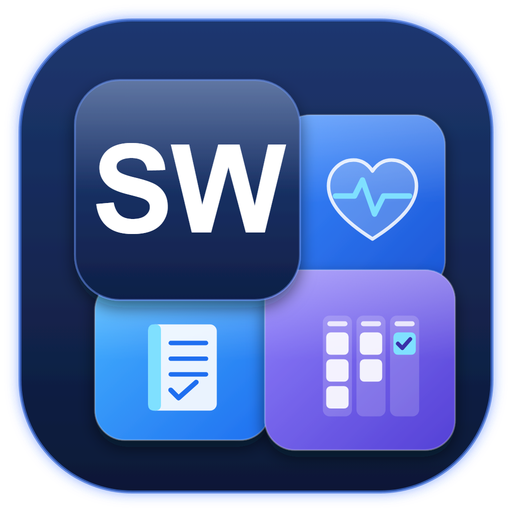</p>

<h1 align="center">SWunja</h1>

<br />

<p align="center">A self-hosted task tracker for your homelab, with the logbook, maintenance schedule, runbooks, ideas and service checks built in. Claude can read and update all of it.</p>

<p align="center">
  <a href="#quick-start">Quick start</a> ·
  <a href="#a-quick-tour">Tour</a> ·
  <a href="#claude-code-mcp">Claude Code</a> ·
  <a href="#configuration">Configuration</a> ·
  <a href="#develop">Develop</a>
</p>

<br />

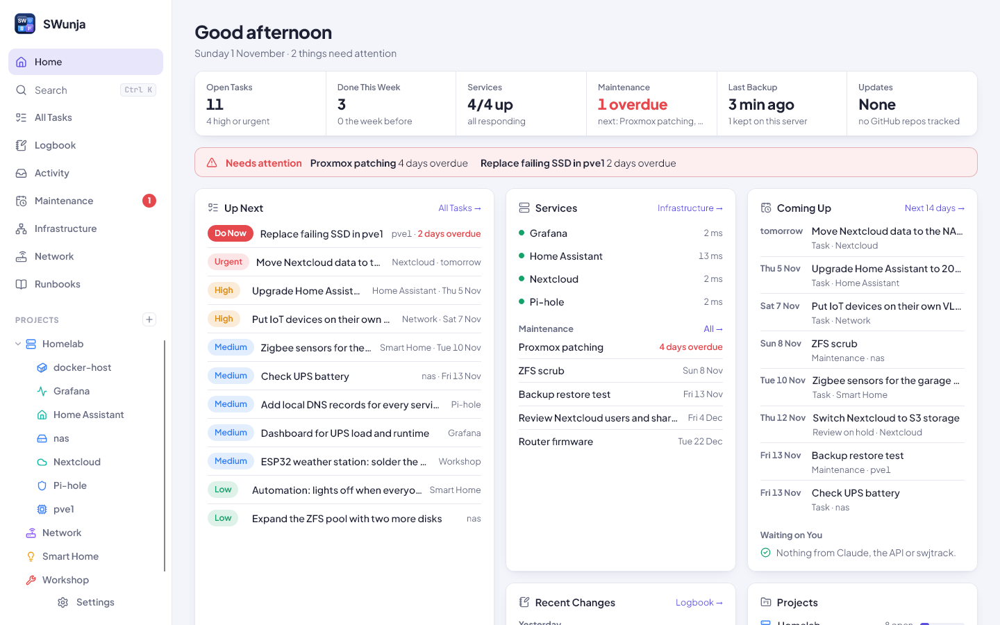

<br />

Most task trackers know nothing about servers, and most homelab dashboards can't hold a to-do list. SWunja keeps both in one place, so it can answer the everyday questions:
- What's broken?
- What's overdue?
- What did I change on that VM last week, and how do I undo it?
- What breaks if I reboot this host?

It's a single container with one SQLite file, built for one person.

<br />

## Quick start

You need Docker with Compose.

```bash
git clone https://github.com/pqpxo/SWunja.git
cd SWunja
docker compose up -d --build
```

Open `http://<your-server>:7760` and choose a password. That's it: no database to set up and no account to create. Everything is stored in the `swunja-data` volume, including the database, attachments and backups.

Whoever opens it first sets the password, so do that straight away, before you make it reachable from anywhere else. To use it away from home, put it behind a reverse proxy with HTTPS (Nginx Proxy Manager, Caddy and so on) rather than opening the port.

<br />

## A quick tour

### Home

Home is a single screen showing what needs you. The status line gives you open tasks, the week's progress, services, maintenance, the last backup and available updates. A **Needs attention** bar appears only when something is down, overdue or due for review.

Below that are three lists:
- **Up Next:** open tasks by priority.
- **Coming Up:** the next 14 days.
- **Recent Changes:** taken from the logbook.

### Projects and tasks

Projects nest as deep as you like, and each one has a **List** and a **Board** view.

<table>
  <tr>
    <td>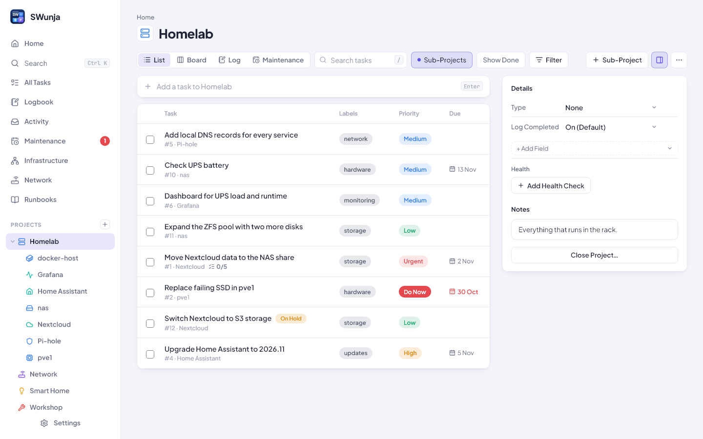</td>
    <td>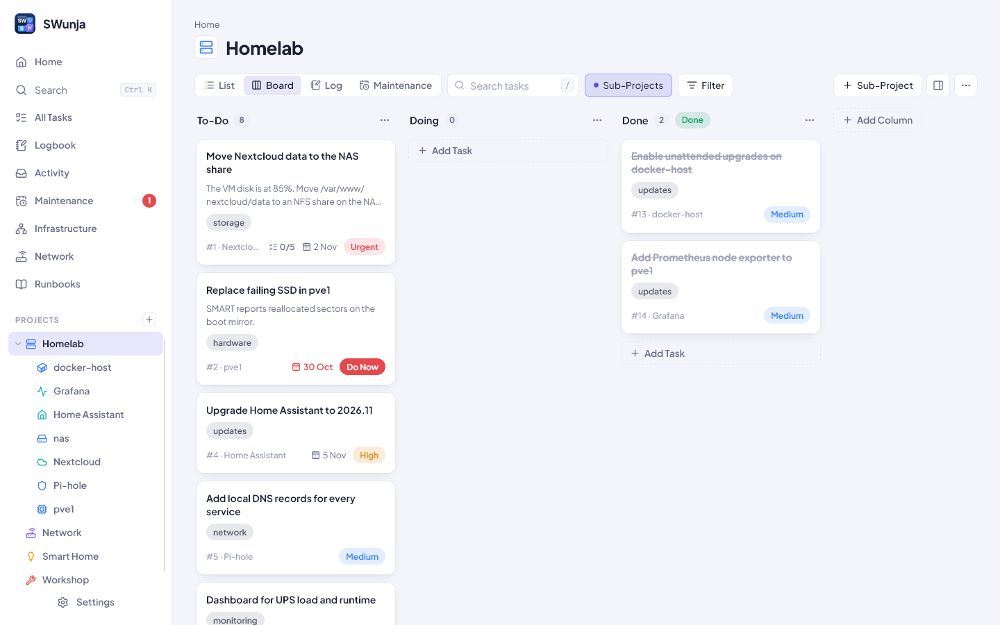</td>
  </tr>
</table>

A task holds:
- a description, plus Issue, Workaround and Proposed Resolution sections;
- Tasks, Requirements and Resources checklists;
- labels, custom fields, attachments and comments;
- a history of who changed what (you, the API or Claude).

Tasks can **repeat**, for example every 3 months counted from the due date or from when you finished. When you close a task or project you mark it Completed, Abandoned or On Hold, with notes, lessons learned and an optional date to review it again.

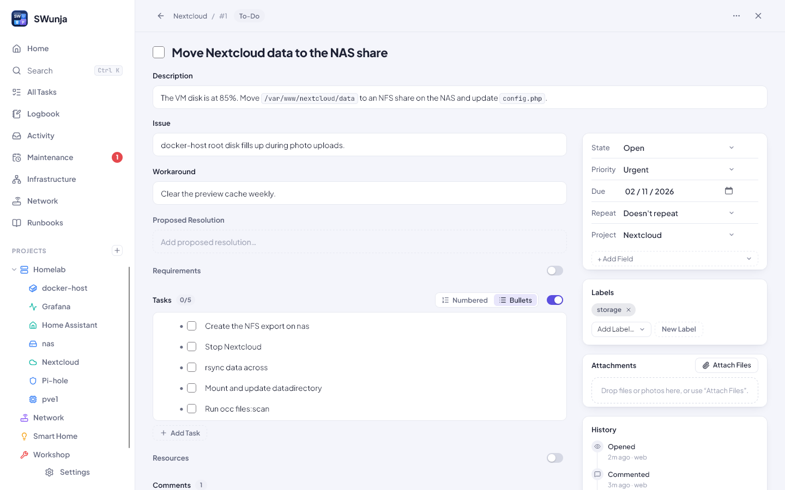

### Ideas

Each project has an **Ideas** tab for thoughts that aren't tasks yet. Type one and press Enter; add notes later if you like. Give each idea a status (New, Maybe, Parked, Done or Rejected) and a reason when you park or reject it, so you remember why. Rejected ideas are hidden unless you ask for them. Pin the ones that matter, and **Make Task** turns a good one into a task that links back to the idea. With Sub-Projects on, a project shows its sub-projects' ideas too.

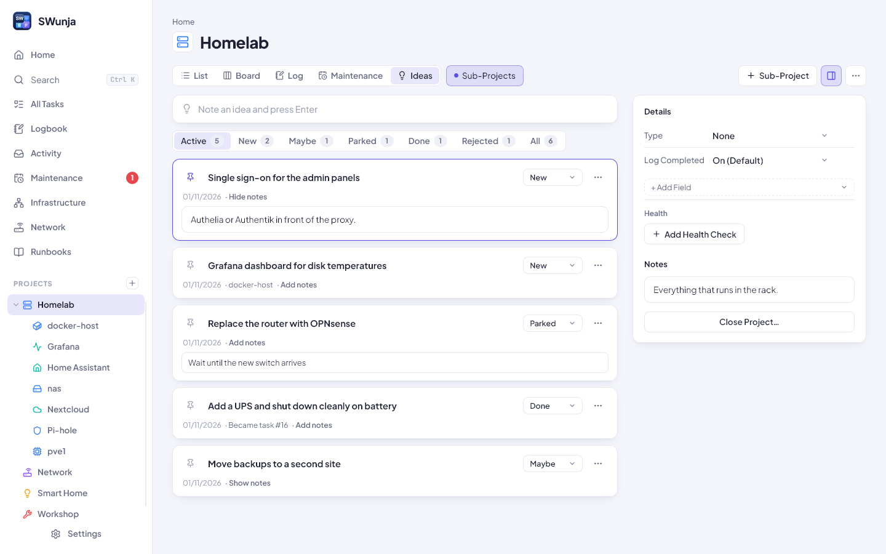

### Runbooks and maintenance

**Runbooks** are step-by-step procedures. Each step can have an expected result, and a runbook can also have rollback steps, a time estimate, a risk level and a downtime flag. Running one ticks off the steps and records the run. Set **Test Every** and SWunja reminds you when a runbook hasn't been run for a while, so you find out it's stale before you need it.

**Maintenance** covers recurring jobs such as patching, certificate renewals, scrubs and restore tests, with last done, next due and overdue alerts. Marking a job done writes it to the logbook.

<table>
  <tr>
    <td>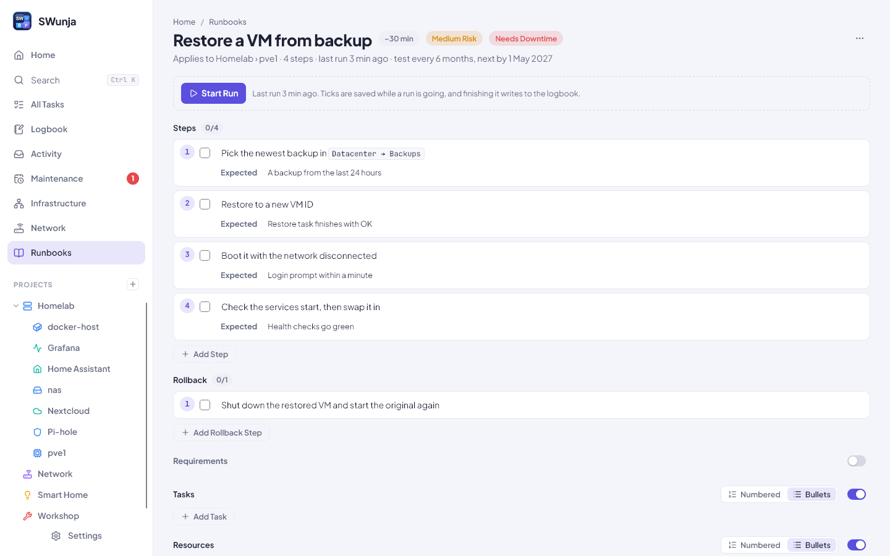</td>
    <td>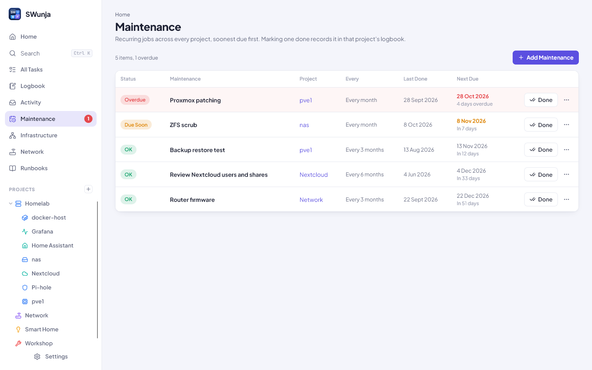</td>
  </tr>
</table>

### Logbook

The logbook records what changed, broke, was maintained or was noticed, per project, with rollback notes. Health-check outages and finished tasks add entries automatically, and scripts can add their own through a webhook.

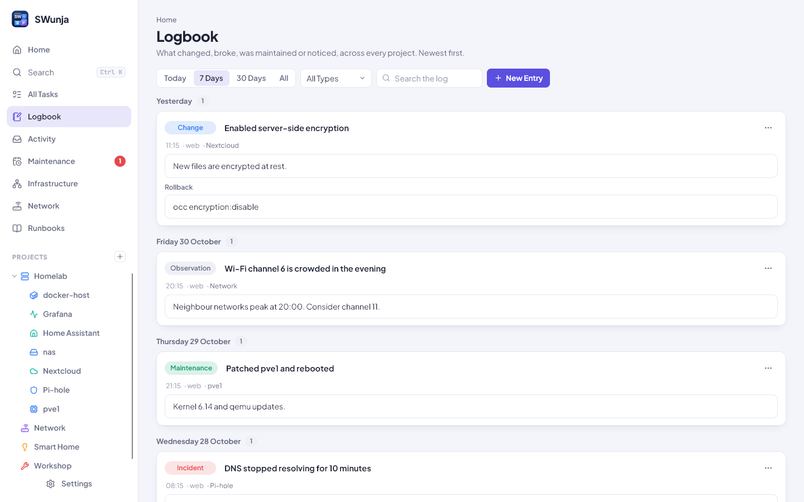

### Infrastructure and network

Give a project a **Runs On** link and SWunja builds the tree: host → VM or LXC → container → app. Ask **What depends on…** before you take something down.

The **Network** page lists subnets and VLANs, which project holds which IP address, and the ports each service publishes. It warns you about clashes. You can import from UniFi Network and Proxmox.

<table>
  <tr>
    <td>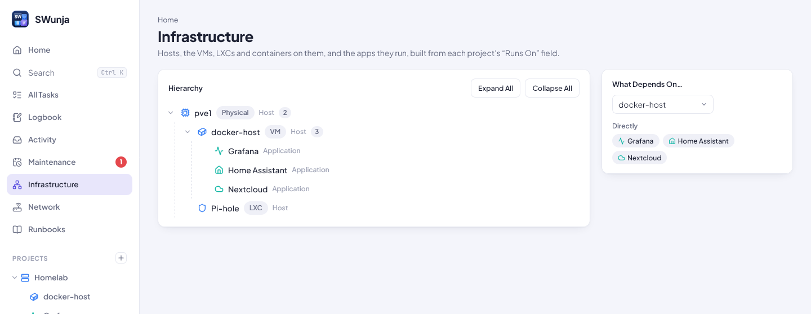</td>
    <td>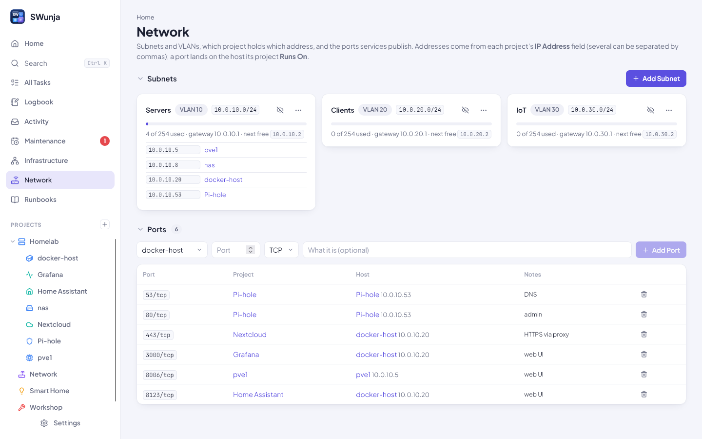</td>
  </tr>
</table>

### Themes and phone

There are eleven themes, including light, dark, Nord, Dracula, Catppuccin and Solarized, plus a choice of accent colour and font. Your choice is saved on the server, so every device looks the same. On a phone the layout collapses into a single column with a slide-out menu.

<table>
  <tr>
    <td width="72%">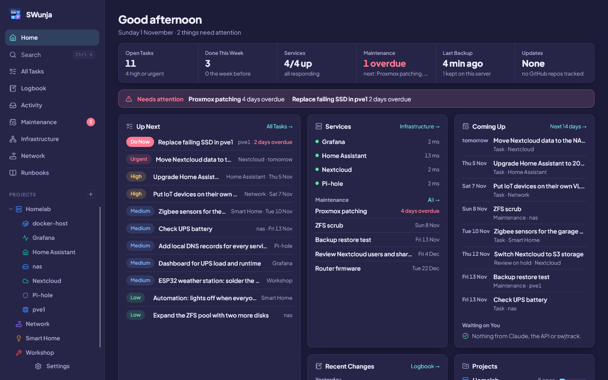</td>
    <td width="28%">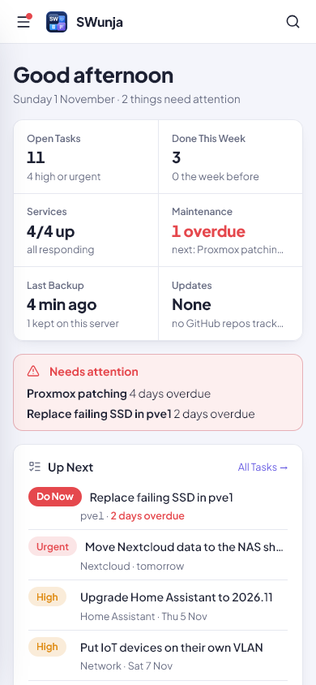</td>
  </tr>
</table>

### Also included

- **Health checks:** HTTP and TCP checks; outages become logbook incidents.
- **Release checks:** compares each app's Version field with its latest GitHub release.
- **Notifications:** ntfy, Gotify, Pushover, Home Assistant, email or a webhook.
- **Custom fields and project types:** text, number, date, select, checkbox, URL and project-link fields, grouped into types such as Application or Host. Sub-projects inherit their parent's type.
- **Search:** <kbd>Ctrl</kbd>+<kbd>K</kbd> searches projects, tasks, the logbook, maintenance, runbooks and ideas.
- **Templates:** save any project or task as a template and reuse it.
- **Activity:** `swjtrack`, a small Linux agent, and a Claude Code hook record what you did on a host. Claude matches it to the right task for you to accept (optional, needs an Anthropic API key).
- **Backups:** daily SQLite and attachment backups, optionally copied to Google Drive.
- **Import and export:** one zip of everything; imports Vikunja exports too.

<br />

## Claude Code (MCP)

SWunja has a built-in [MCP](https://modelcontextprotocol.io) server. In **Settings → API Tokens & MCP**, generate a token, then:

```bash
claude mcp add --transport http swunja http://<your-server>:7760/mcp --header "Authorization: Bearer <token>"
```

Claude can then work with SWunja directly. For example:
- "What's overdue?"
- "Log that I upgraded Docker on docker-host, with rollback steps."
- "Create a runbook for restoring Nextcloud."
- "What depends on pve1?"
- "Mark the ZFS scrub done."
- "Note an idea for Homelab: try Frigate for the cameras."

Changes Claude makes show up in each task's history and are marked as new in the web UI until you open them.

<br />

## swjtrack (optional)

To record what you do on a Linux host, install the agent there:

```bash
curl -fsSL http://<your-server>:7760/swjtrack/install | sh
```

The installer asks for an API token, which folders to watch, and how often to remind you to sync.

<br />

## Configuration

| Variable | Default | What it does |
| --- | --- | --- |
| `SWUNJA_PORT` | `7760` | Port on the host. Set it in your shell or in a `.env` file next to `docker-compose.yml`. |
| `BACKUP_DIR` | `/data/backups` | Where backups go; point it at another disk or a NAS mount. |
| `LOG_LEVEL` | `info` | Server log level. |
| `TRUST_PROXY` | private addresses | Which reverse proxies may set `X-Forwarded-*` headers: `true`, `false`, or a comma-separated list of addresses or CIDRs. The default trusts private addresses (a proxy on your LAN or in Docker). |

`BACKUP_DIR`, `LOG_LEVEL` and `TRUST_PROXY` go in an `environment:` block under the service in `docker-compose.yml`. If you move the backups, mount that folder into the container too.

Everything else is set up in **Settings**, including backups, notification channels, the Claude API key, Google Drive, UniFi, Proxmox, the GitHub token, themes and the sidebar. API keys are write-only: once saved they're never shown again, and they're never included in exports.

To restore a backup, stop the container. Replace `samunja.db` and the `files/` folder in the data volume with the ones from the backup zip, delete `samunja.db-wal` and `samunja.db-shm`, then start the container again. Each zip includes these steps.

<br />

## Develop

You need Node 24. There's no build step for the server: Node runs the TypeScript directly.

```bash
npm install
npm test                                  # server tests (node --test)
PORT=7760 DATA_DIR=./data npm run dev     # API + MCP on :7760
npm run dev:web                           # Vite dev server, proxies /api and /mcp to :7760
npm run build                             # web UI -> web/dist
```

The stack is Fastify, `node:sqlite`, React 19, Vite and the MCP TypeScript SDK.

The screenshots show made-up demo data.

<br />

## License

MIT, see [LICENSE](LICENSE).
